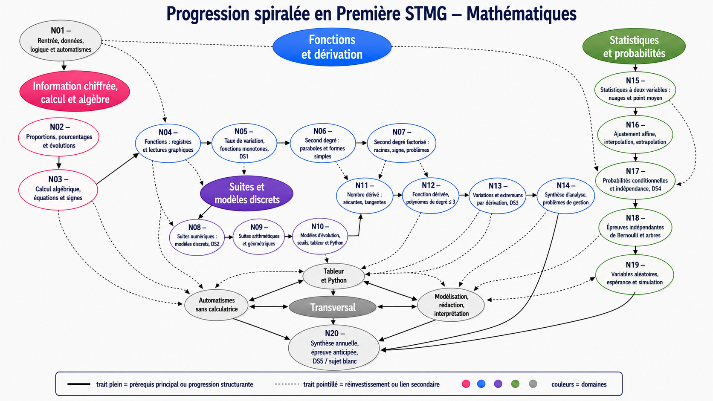

# Progression visuelle

La carte ci-dessous montre les notions de Première STMG mathématiques, regroupées par domaine, et leurs liens : prérequis en trait plein, réinvestissements et liens secondaires en pointillé.

## Progression calendaire

[Ouvrir la progression calendaire (PDF)](assets/documents/Progression_calendrier_1stmg.pdf)

## Carte de progression

**Cliquez sur une bulle pour ouvrir la page de la notion.**

<!-- CARTE-PROGRESSION:DEBUT -->

<button type="button" class="carte-fermer" aria-label="Fermer la carte agrandie">✕ Fermer</button>

[N01 – Rentrée, données, logique et automatismes](notions/N01-rentree-donnees-logique.md){.bulle-progression style="left:2.87%;top:5.10%;width:11.24%;height:9.88%" title="N01 – Rentrée, données, logique et automatismes"}
[N02 – Proportions, pourcentages et évolutions](notions/N02-proportions-pourcentages-evolutions.md){.bulle-progression style="left:2.69%;top:29.44%;width:11.06%;height:9.25%" title="N02 – Proportions, pourcentages et évolutions"}
[N03 – Calcul algébrique, équations et signes](notions/N03-calcul-algebrique-equations.md){.bulle-progression style="left:2.69%;top:42.40%;width:10.89%;height:9.78%" title="N03 – Calcul algébrique, équations et signes"}
[N04 – Fonctions : registres et lectures graphiques](notions/N04-fonctions-registres-lectures.md){.bulle-progression style="left:19.08%;top:31.03%;width:8.91%;height:9.35%" title="N04 – Fonctions : registres et lectures graphiques"}
[N05 – Taux de variation, fonctions monotones, DS1](notions/N05-taux-variation-fonctions.md){.bulle-progression style="left:29.78%;top:30.92%;width:8.91%;height:9.46%" title="N05 – Taux de variation, fonctions monotones, DS1"}
[N06 – Second degré : paraboles et formes simples](notions/N06-second-degre-paraboles.md){.bulle-progression style="left:40.79%;top:30.92%;width:8.97%;height:9.46%" title="N06 – Second degré : paraboles et formes simples"}
[N07 – Second degré factorisé : racines, signe, problèmes](notions/N07-second-degre-factorise.md){.bulle-progression style="left:51.56%;top:30.92%;width:9.45%;height:9.35%" title="N07 – Second degré factorisé : racines, signe, problèmes"}
[N08 – Suites numériques : modèles discrets, DS2](notions/N08-suites-numeriques-modeles.md){.bulle-progression style="left:23.86%;top:54.84%;width:7.48%;height:8.71%" title="N08 – Suites numériques : modèles discrets, DS2"}
[N09 – Suites arithmétiques et géométriques](notions/N09-suites-arithmetiques-geometriques.md){.bulle-progression style="left:32.78%;top:54.73%;width:7.00%;height:8.50%" title="N09 – Suites arithmétiques et géométriques"}
[N10 – Modèles d'évolution, seuils, tableur et Python](notions/N10-evolution-seuils-python.md){.bulle-progression style="left:41.09%;top:54.52%;width:7.54%;height:8.61%" title="N10 – Modèles d'évolution, seuils, tableur et Python"}
[N11 – Nombre dérivé : sécantes, tangentes](notions/N11-nombre-derive-tangentes.md){.bulle-progression style="left:47.25%;top:44.53%;width:7.78%;height:8.50%" title="N11 – Nombre dérivé : sécantes, tangentes"}
[N12 – Fonction dérivée, polynômes de degré ≤ 3](notions/N12-fonction-derivee-polynomes.md){.bulle-progression style="left:56.52%;top:44.42%;width:7.72%;height:8.61%" title="N12 – Fonction dérivée, polynômes de degré ≤ 3"}
[N13 – Variations et extremums par dérivation, DS3](notions/N13-variations-extremums.md){.bulle-progression style="left:65.85%;top:44.53%;width:7.78%;height:8.50%" title="N13 – Variations et extremums par dérivation, DS3"}
[N14 – Synthèse d'analyse, problèmes de gestion](notions/N14-synthese-analyse-gestion.md){.bulle-progression style="left:75.42%;top:44.53%;width:7.83%;height:8.50%" title="N14 – Synthèse d'analyse, problèmes de gestion"}
[N15 – Statistiques à deux variables : nuages et point moyen](notions/N15-statistiques-deux-variables.md){.bulle-progression style="left:83.49%;top:17.96%;width:11.12%;height:8.61%" title="N15 – Statistiques à deux variables : nuages et point moyen"}
[N16 – Ajustement affine, interpolation, extrapolation](notions/N16-ajustement-affine.md){.bulle-progression style="left:83.91%;top:28.91%;width:10.29%;height:9.14%" title="N16 – Ajustement affine, interpolation, extrapolation"}
[N17 – Probabilités conditionnelles et indépendance, DS4](notions/N17-probabilites-conditionnelles.md){.bulle-progression style="left:83.61%;top:40.49%;width:10.94%;height:8.93%" title="N17 – Probabilités conditionnelles et indépendance, DS4"}
[N18 – Épreuves indépendantes de Bernoulli et arbres](notions/N18-bernoulli-arbres.md){.bulle-progression style="left:84.03%;top:52.18%;width:10.05%;height:9.03%" title="N18 – Épreuves indépendantes de Bernoulli et arbres"}
[N19 – Variables aléatoires, espérance et simulation](notions/N19-variables-aleatoires-esperance.md){.bulle-progression style="left:83.61%;top:63.66%;width:10.77%;height:9.56%" title="N19 – Variables aléatoires, espérance et simulation"}
[N20 – Synthèse annuelle, épreuve anticipée, DS5 / sujet blanc](notions/N20-synthese-annuelle-epreuve.md){.bulle-progression style="left:40.55%;top:81.19%;width:12.50%;height:10.95%" title="N20 – Synthèse annuelle, épreuve anticipée, DS5 / sujet blanc"}
[Automatismes sans calculatrice](automatismes/index.md){.bulle-progression style="left:25.96%;top:72.37%;width:8.73%;height:7.33%" title="Automatismes sans calculatrice"}

<button type="button" class="carte-agrandir md-button">Agrandir la carte (plein écran, bulles cliquables)</button>
<!-- CARTE-PROGRESSION:FIN -->
